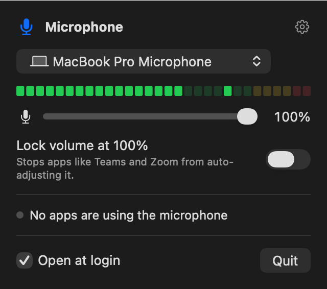

# Mic Volume

A macOS menu bar app for monitoring and controlling your microphone input volume.



## Features

- **Volume at a glance:** the menu bar item shows the current input volume, such as `72%`, and turns into a red slashed microphone when muted.
- **Control panel:** click the menu bar item for a live level meter, an input device picker, a volume slider, and a mute button.
- **Lock volume:** keeps the input volume where you set it by reverting changes made by other apps, such as the automatic adjustments in Teams and Zoom. Locks are saved per device.
- **Sticky mute:** a mute set in Mic Volume stays on until you unmute it there, even if another app tries to unmute the microphone. Inputs without a hardware mute are muted by setting their volume to 0.
- **Mic in use:** the panel shows which apps are using the microphone.
- **Shortcuts:** right-click (or Control-click) the menu bar item for a quick menu, Option-click it to toggle mute, or scroll over it to change the volume. These gestures haven't been tested on macOS 27 yet.
- **Open at login:** turned on the first time the app runs. You can change it in the panel.

## Requirements

- A Mac with Apple silicon running macOS 14 or later (tested on macOS 27)
- Xcode or the Command Line Tools (`xcode-select --install`)

## Build and install

```sh
./build.sh
```

This compiles the app, installs it to `~/Applications/Mic Volume.app`, and launches it, replacing any copy that's already running. To build without installing, run `./build.sh --no-install`; the app is written to `build/`.

The first time you open the panel, macOS asks for microphone access. Only the level meter needs it; the volume, mute, and lock controls work without it. The app is signed ad hoc, so macOS asks again after each rebuild.

To uninstall, clear **Open at login** in the panel, click **Quit**, and delete `~/Applications/Mic Volume.app`.

## Diagnostics

The app binary accepts a few options for testing:

```sh
app="$HOME/Applications/Mic Volume.app/Contents/MacOS/MicVolume"
"$app" --self-test          # tests volume, mute, and lock on an idle input other than the default, then restores it
"$app" --snapshot panel.png # renders the panel to a PNG
"$app" --preview            # opens the panel in a window with a simulated meter
```

`--snapshot` and `--preview` don't use the microphone.

## License

[MIT](LICENSE)
